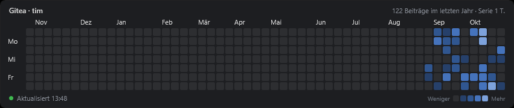
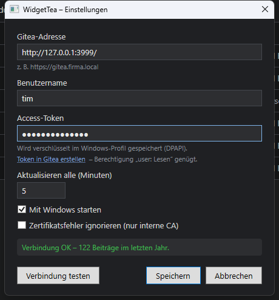

# WidgetTea

Desktop-Widget für Windows, das die eigene Contribution-Heatmap aus einem [Gitea](https://about.gitea.com/) anzeigt.



- liegt auf Desktop-Ebene (unter allen Fenstern, bleibt bei Win+D sichtbar), nicht in Taskleiste/Alt-Tab
- Abgleich nur, wenn Gitea erreichbar ist – sonst letzter Stand aus dem Cache („Offline – Stand …“)
- Abgleich alle paar Minuten, zusätzlich nach Netzwerkwechsel und Aufwachen aus dem Standby
- Tray-Icon: Aktualisieren, Position fixieren, Autostart, Einstellungen (Doppelklick), Updates
- aktualisiert sich selbst über die [Releases](https://github.com/Celestial0579/WidgetTea/releases)

## Installation

`WidgetTea-<version>-setup.exe` aus den [Releases](https://github.com/Celestial0579/WidgetTea/releases/latest) laden und ausführen.
Installiert wird nur für das eigene Benutzerkonto (`%LOCALAPPDATA%\Programs\WidgetTea`), ohne Adminrechte; die .NET-Laufzeit ist enthalten.

Beim ersten Start öffnet sich das Einstellungsfenster:



Gitea-Adresse, Benutzername und Access-Token eintragen (Gitea → Einstellungen → Anwendungen → Token mit Berechtigung *user: Lesen*),
mit „Verbindung testen“ prüfen und speichern.

Unbeaufsichtigt: `WidgetTea-<version>-setup.exe /S`

## Datenablage

Alles unter `%LOCALAPPDATA%\WidgetTea\`:

| Datei | Inhalt |
|---|---|
| `settings.json` | Adresse, Benutzer, Intervall, Fensterposition – **keine Geheimnisse** |
| `credentials.bin` | Access-Token, DPAPI-verschlüsselt (CurrentUser + App-Entropy), nur für das eigene Windows-Konto lesbar |
| `cache.json` | letzter Stand der Heatmap für den Offline-Betrieb |

Das Token wird nur über das Einstellungsfenster gesetzt und nie im Klartext auf die Platte geschrieben.

Datenquelle: `GET /api/v1/users/{username}/heatmap` (setzt `ENABLE_USER_HEATMAP = true` voraus, Gitea-Standard).

## Updates

WidgetTea fragt kurz nach dem Start und danach alle 6 Stunden `releases/latest` des Repositorys ab
(`<UpdateRepository>` in `WidgetTea.csproj`, GitHub oder Gitea). Ist eine neuere Version da, wird das Setup geladen,
gegen die mitveröffentlichte `.sha256` geprüft und still mit `/S /RESTART` installiert – oder, wenn
„Updates automatisch installieren“ aus ist, per Tray-Hinweis angeboten. Ohne passende Prüfsumme wird nichts installiert.

## Bauen & Release

Voraussetzungen: .NET 10 SDK, [NSIS](https://nsis.sourceforge.io/) (`winget install NSIS.NSIS`), für Releases die `gh`-CLI.

```powershell
.\build\release.ps1            # baut artifacts\<version>\WidgetTea-<version>-setup.exe (+ .sha256)
.\build\release.ps1 -Publish   # zusätzlich Tag v<version> pushen und GitHub-Release anlegen
```

Für ein neues Release vorher `<Version>` in `WidgetTea.csproj` erhöhen und committen.

## Lizenz

[MIT](LICENSE) © 2026 Tim Heyne
