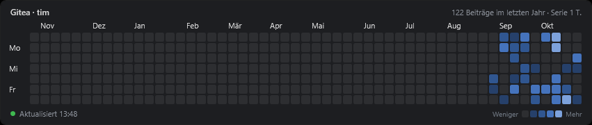
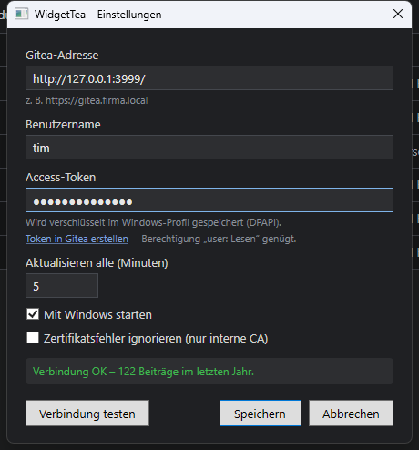

# WidgetTea

Desktop-Widget für Windows, das die eigene Contribution-Heatmap aus einem [Gitea](https://about.gitea.com/) anzeigt.



- liegt auf Desktop-Ebene (unter allen Fenstern, bleibt bei Win+D sichtbar), nicht in Taskleiste/Alt-Tab
- Abgleich nur, wenn Gitea erreichbar ist – sonst letzter Stand aus dem Cache („Offline – Stand …“)
- Abgleich alle paar Minuten, zusätzlich nach Netzwerkwechsel und Aufwachen aus dem Standby
- Tray-Icon: Aktualisieren, Position fixieren, Autostart, Einstellungen (Doppelklick), Updates
- aktualisiert sich selbst über die [Releases](https://github.com/Celestial0579/WidgetTea/releases)

## Installation

`WidgetTea-<version>-setup.exe` aus den [Releases](https://github.com/Celestial0579/WidgetTea/releases/latest) laden und ausführen.
Installiert wird nur für das eigene Benutzerkonto (`%LOCALAPPDATA%\Programs\WidgetTea`), ohne Adminrechte.
Voraussetzung ist die [.NET Desktop Runtime 10](https://dotnet.microsoft.com/download/dotnet/10.0) (x64, mindestens 10.0.14). Fehlt sie oder ist sie veraltet,
fragt das Setup – auch bei einem Selbst-Update – vor der Installation nach und installiert sie per `winget` (Adminrechte nötig);
wo `winget` fehlt oder scheitert, öffnet es den Download von Microsoft.
Die Abfrage der Benutzerkontensteuerung zeigt Windows dabei oft nicht von selbst, sondern nur als blinkendes Schild in der Taskleiste.
Sicherheitsupdates der Laufzeit kommen danach über Windows Update.

Wer die Nachfrage ablehnt, behält die bisherige Version: Geprüft wird, bevor das Setup irgendetwas anfasst.
Nach einem abgelehnten Selbst-Update schaltet das Setup „Updates automatisch installieren“ aus, weil WidgetTea
dasselbe Update sonst nach jedem Start erneut lüde. Das Update lässt sich über das Tray-Symbol nachholen,
danach sind automatische Updates wieder an. Bleibt die Nachfrage bei einem Selbst-Update zwei Minuten
unbeantwortet, verfährt das Setup genauso: WidgetTea läuft in der bisherigen Version weiter, und ein Hinweis
wartet auf dem Bildschirm.

Beim ersten Start öffnet sich das Einstellungsfenster:



Gitea-Adresse, Benutzername und Access-Token eintragen (Gitea → Einstellungen → Anwendungen → Token mit Berechtigung *user: Lesen*),
mit „Verbindung testen“ prüfen und speichern.

Unbeaufsichtigt: `WidgetTea-<version>-setup.exe /S`. Fehlt dabei die Laufzeit, endet das Setup ohne Nachfrage mit Exitcode 3 und ändert nichts.

Die Deinstallation entfernt genau die Dateien, die das Setup installiert hat. Liegt im Installationsordner noch etwas anderes,
bleibt es samt Ordner stehen. Einstellungen, Token und Cache bleiben ebenfalls, solange „Benutzerdaten entfernen“ nicht gewählt ist.

## Datenablage

Alles unter `%LOCALAPPDATA%\WidgetTea\`:

| Datei | Inhalt |
|---|---|
| `settings.json` | Adresse, Benutzer, Intervall, Fensterposition – **keine Geheimnisse** |
| `credentials.bin` | Access-Token, DPAPI-verschlüsselt (CurrentUser + App-Entropy), nur für das eigene Windows-Konto lesbar |
| `cache.json` | letzter Stand der Heatmap für den Offline-Betrieb |
| `autoupdate-paused` | leerer Merker, nur nach einem abgelehnten Selbst-Update: Das Setup hat „Updates automatisch installieren“ ausgeschaltet und schaltet es beim nächsten Update wieder ein |

Das Token wird nur über das Einstellungsfenster gesetzt und nie im Klartext auf die Platte geschrieben.

Datenquelle: `GET /api/v1/users/{username}/heatmap` (setzt `ENABLE_USER_HEATMAP = true` voraus, Gitea-Standard).

## Updates

WidgetTea fragt kurz nach dem Start und danach alle 6 Stunden `releases/latest` des Repositorys ab
(`<UpdateRepository>` in `WidgetTea.csproj`, GitHub oder Gitea). Ist eine neuere Version da, wird das Setup geladen,
gegen die mitveröffentlichte `.sha256` geprüft und still mit `/S /RESTART` installiert – oder, wenn
„Updates automatisch installieren“ aus ist, per Tray-Hinweis angeboten. Ohne passende Prüfsumme wird nichts installiert.

Läuft nach einem begonnenen Update noch die alte Version, ist die Installation gescheitert. WidgetTea versucht dieselbe
Version dann nicht bei jedem Start erneut, sondern frühestens nach 24 Stunden und höchstens dreimal von selbst; über das
Tray-Menü lässt sich das Update jederzeit von Hand starten.

## Bauen & Release

Voraussetzungen: .NET 10 SDK, [NSIS](https://nsis.sourceforge.io/) (`winget install NSIS.NSIS`), für Releases die `gh`-CLI.

```powershell
.\build\release.ps1            # baut artifacts\<version>\WidgetTea-<version>-setup.exe (+ .sha256)
.\build\release.ps1 -Publish   # zusätzlich Tag v<version> pushen und GitHub-Release anlegen
```

Für ein neues Release vorher `<Version>` in `WidgetTea.csproj` erhöhen und committen.

Verlangt eine neue Fassung eine neuere .NET-Laufzeit, `DOTNET_MINPATCH` in `installer/WidgetTea.nsi` anheben.

### Tests

```powershell
dotnet test tests\WidgetTea.Tests\WidgetTea.Tests.csproj   # Unit-Tests des Updaters
```

Bei jedem Pull Request baut die CI (`.github/workflows/ci.yml`) App und Setup, lässt die Unit-Tests laufen und prüft
das Setup still: Neuinstallation, Update vom veröffentlichten 1.0.0, Abbruch ohne passende Laufzeit, das abgelehnte und das
unbeantwortete Selbst-Update, die Deinstallation aus einem Ordner mit fremden Dateien und dass das Setup keine fremden
Programme startet, die neben ihm liegen und wie Hilfsprogramme von Windows heißen, und dass es die laufende App an ihr
selbst erkennt und nicht am Programmnamen, und dass ein Update nur die Dateien der vorigen Fassung entfernt. Das gebaute Setup hängt als Artefakt am Lauf. Die Installer-Prüfungen (`tests\installer\Test-Installer.ps1`)
installieren und deinstallieren WidgetTea für den angemeldeten Benutzer – sie gehören in die CI, nicht auf den eigenen Rechner.
Ein zweiter Job stellt das Selbst-Update nach, wie die App es auslöst (`tests\update\Test-SelfUpdate.ps1`): Die gebaute
App fragt einen Update-Server auf dem Runner, lädt ein „neueres" Setup und installiert es; ein zweites Mal scheitert
das Setup, und die App darf es danach nicht bei jedem Start erneut versuchen.
Veröffentlicht wird in der CI nichts.

## Lizenz

[MIT](LICENSE) © 2026 Tim Heyne
